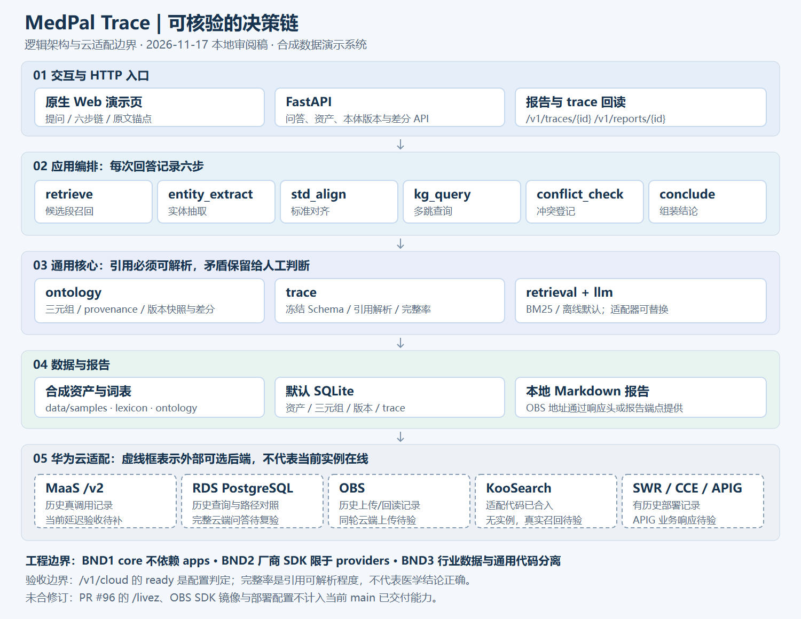

# MedPal Trace —— 可核验的临床决策链应用

> 赛题：第十一届华为 ICT 大赛 · 中国创新赛 · 赛题 1「基于华为云产品打造 AI 创新应用」  
> 队伍：链证小队（北京工业大学）　队长：t1　队员：t2、t3  
> 仓库：https://github.com/xiangyuli494-cmyk/medpal-trace　分支：`main`（可复现）  
> 版本：D2 提交候选稿（2026-11-24，源码基线 main `516889c`；尚未发布冻结 tag）　性质：**合成数据演示系统，非医疗器械，不用于临床诊断**

---

## 0. 一页读完

这个作品只回答一个问题：**当一条结论被给出时，谁能证明它从哪来、经过哪几步、哪一步是猜的。**

三句话说清它是什么：

1. 把院内散落的诊疗资料解析成**带锚点的资产**（`AST-2026-8adab8#s1.p1.c2` 这种地址，能点回原文那一段）；
2. 用本体三元组走多跳推理，产出**六步决策链**（检索 → 实体识别 → 标准对齐 → 图查询 → 冲突体检 → 结论），步骤必填 `i / op / evidence`，`in / out / confidence` 按实际结果可选记录；
3. 整条链写进 `trace` 表、出报告、算**溯源完整率**；挂不上引用的部分不藏，直接进 `gaps` 说明缺什么。

系统默认使用 SQLite、BM25 与离线模型。云适配器按配置启用：未配置 OBS 时保留本地报告；显式选择远端数据库但缺 DSN 会报错，不会静默回落。`/v1/cloud` 的 ready 是配置是否齐全的判定，不是远端存活或读写探测。

| 我们实测过的数字 | 值 | 出处 |
| --- | --- | --- |
| 评测集规模 | 60 条（6 条手写 + 54 条合成，问句重复率 0） | `eval/dataset/v2.jsonl` |
| 科室准确率 / 检查召回 | 0.967 / 1.000 | `bash tools/dev.sh all` |
| 溯源完整率 | 1.000（零证据条数 0） | 同上 |
| 平均步数 / 平均耗时 | 6.63 步 / 7.3 ms（离线桩） | 同上 |
| PostgreSQL 18.6 真机 | 九步自检全绿，PG 路径数 8 == SQLite 路径数 8 | `docs/cloud-evidence/20261110-rds-final/pg.log` |
| RDS 真机压测（c=8, n=40） | rps 2.16 / P50 3023 ms / P95 4504 ms | 同上 `load.log` |
| OBS 真机 | 七步自检全绿（endpoint、SDK、桶就绪、上传、下载、列举、删除） | `docs/cloud-resources.md` §4.1 |
| 真模型 | DeepSeek 官方 API 接入零代码改动，30 条评测指标一字未变 | `docs/evidence/2026-11-08-deepseek.md` |
| 自动化测试 | main `516889c` 必需 CI 通过；未合 PR #96 的结果不能混计为主分支结果 | `.github/workflows/ci.yml` |

---

## 1. 问题：为什么「答对」还不够

医疗场景的失败模式不是「答错」，是**答了但没人能验**。

现有做法给一段检索来的文本，然后让模型组织语言。这段文本出自哪一版资料、哪一页、哪一句，模型自己不知道，医生也没法在 30 秒内确认。后果是三件事同时发生：

- **出错无法定位**：结论错了，分不清是资料过期、解析错了、还是推理跳步；
- **修订无法传播**：资料更新后，旧结论仍散落在报告与截图里；
- **责任无法界定**：谁也说不清这条建议依据的是哪条规则。

这三件事比「模型准不准」更要命。所以我们的切入点不是换个更大的模型，而是把**可追溯做成可执行契约**：JSON Schema 定义什么叫「有据可查」，校验器与之配套，完整率作为指标进评测与门禁。承诺写在文档里没人验，写进 schema 就有人验。

**演示范围**（见 `docs/00-赛题理解.md`，数据声明以本节为准）：

- 不下诊断结论，不给用药剂量，不承诺疗效；
- 输出只到「科室 + 建议检查 + 已收录药品名称」，用于导诊分流与资料追溯；
- 演示数据全部合成，`data/samples/peptic_ulcer_pathway.md` 是自造语料，不含真实病历。

---

## 2. 方案总览

图 1 将交互、应用编排、通用核心、数据与云适配分开展示；模块依赖由 BND1–3 检查。



图 1 源文件：[SVG](figures/medpal-architecture.svg) · [HTML 预览](figures/medpal-architecture.html)。虚线表示外部适配，不表示当前实例在线。


| 层 | 做什么 | 代码位置 |
| --- | --- | --- |
| 资产层 | 原件 → 解析成锚点 → 入库；同源多次入库可差分（`version.diff_versions`） | `packages/core/medpal_core/assets/parsers.py`、`ontology/version.py` |
| 本体层 | 实体归一、三元组（带 provenance + confidence）、两跳查询、冲突体检 | `ontology/store.py`（594 行，本项目最重的一块） |
| 应用层 | 一次提问产出六步链、落库、出报告、算完整率；HTTP 契约与前端 | `apps/api/app/pipeline.py`、`apps/api/app/main.py`、`apps/web/index.html` |

分层纪律不是口号，是 CI 里会红的检查：`tools/check_boundaries.py` 三条规则（BND1/BND2/BND3），`bash scripts/verify.sh --self-test` 会**故意制造**一次 BND1 违规来证明检查真的会失败——不会失败的检查等于没有检查。

---

## 3. 技术实现

### 3.1 契约：可追溯是 schema 里的必填字段

`packages/core/medpal_core/contracts/trace/schema.json` 冻结 v1：

| 项 | 内容 |
| --- | --- |
| 8 个必填字段 | `schema` `trace_id` `question` `agent_version` `ontology_version` `steps` `gaps` `trace_completeness` |
| 顶层约束 | `additionalProperties: false`（多一个字段就校验失败） |
| 步骤对象 | 序列化输入键为 `in`；输出、证据及引用类型按冻结 schema 校验，`op` 取自 11 个枚举 |
| 冻结方式 | `tests/test_contracts.py` 断言 v1 的字节长度与 sha256（5752 字节 / `b778690b…4f53c`，LF 规范化） |

冻结的代价是真实的：B7 要把「报告在 OBS 上的地址」暴露给前端，最省事的做法是给 trace body 加一个 `report_uri` 字段——**加不了**，会同时打破 `additionalProperties: false` 与那条 sha256 断言。最终改走响应头 `X-Medpal-Report-Uri` 加独立端点 `GET /v1/reports/{id}`，契约一字未动。契约一旦能被随手改，它就不再是契约。

### 3.2 六步决策链

`apps/api/app/pipeline.py` 的 `answer()` 按顺序产出六步，每步都能单独复算：

| # | op | 做什么 | 证据形态 |
| --- | --- | --- | --- |
| 1 | `retrieve` | 检索（bm25 或 KooSearch）取候选段 | `asset_id#anchor` + 相似度 |
| 2 | `entity_extract` | 词表最长匹配抽实体 | 命中词与位置 |
| 3 | `std_align` | 实体归一到本体节点 | `node_id` + 对齐来源 |
| 4 | `kg_query` | 两跳图查询（`max_hops=2`，可配） | 每条路径的 `triple_id`、provenance、confidence |
| 5 | `conflict_check` | 同 head + 同 rel 指向两个 tail 时登记矛盾 | 冲突对的两条 `triple_id` |
| 6 | `conclude` | 组装科室 / 检查 / 药品，算完整率 | 引用集合 + `gaps` |

真机跑出来的一条链（RDS PostgreSQL 18.6，`docs/cloud-evidence/20261110-rds-final/api.log`）：

```text
statement : 上腹隐痛 -[提示]-> 消化性溃疡 -[确诊检查]-> 胃镜
dept      : 消化内科
exams     : [胃镜]
evidence  : 10 条引用，trace_completeness = 1.0
```

注意这条链的语言：它是**三元组路径的直译**，不是模型自由发挥的段落。结构化结论来自本体路径；模型可补充 narrative，模型调用异常时在 conclusion.llm_error 中记录错误。默认离线与真实云端生成分别标注。这样「模型好坏」不会污染「结论从哪来」。

### 3.3 完整率与拒答：拒答不该比答错得分高

```text
completeness = 1 - 未被解析的引用数 / 引用总数
零引用 → trace.refusal = true；trace 完整率约定为 1.0，评测对该样本计 0.0
```

这条口径在项目里踩过一次坑：trace 层曾把「零引用」记为 1.0（干净利落），评测层记 0.0，前端把 1.0 画成 100% —— 三处口径打架，结果**拒答比答错分更高**。当前实现分三层：trace 层零引用记 1.0 并置 refusal；eval 层零证据样本按 0.0 纳入全部 n 条的平均值，并计 zero_evidence；前端显示「拒答·不计分」。本次 BM25 60 条中零证据为 0。审计清单里 18 条问题有 3 条属于这类「文档口径超前于代码」，全部已改。

### 3.4 冲突不裁决，只登记

本体自相矛盾时（同一 head + 同一 rel 指向两个 tail），系统**不挑一个更可信的**，而是把两条 `triple_id` 连同来源一起写进 `gaps`，交人判断。理由：自动裁决会隐藏分歧，而分歧本身是资料质量的信号。测试 `tests/test_conflict.py` 与 `tests/test_conflict_ref.py` 覆盖；演示时现场制造一次冲突，`gaps` 立刻多一条。

### 3.5 换行业：只换数据，不换代码

BND3 规则让 core 代码里不出现任何行业术语（tokenize 去掉注释与字符串后再扫，避免误伤注释）。换行业只改两个文件：`data/lexicon/<行业>.json` 与 `data/ontology/seed.jsonl`。现有 60 条数据和未配置云端的消融只验证了部分可替换行为，不能据此断言任意新行业、真实检索器或模型不会改变效果（见 §5.3）。

---

## 4. 华为云融合

### 4.1 五个插槽，逐条指到代码行

| 插槽 | 华为云服务 | 代码位置 | 不配时的退化行为 | 状态 |
| --- | --- | --- | --- | --- |
| 模型 | ModelArts Studio（OpenAI 兼容端点） | `providers/huawei/modelarts.py`、`llm/openai_compatible.py` | 默认离线；调用失败记录 `llm_error` | 11/23 连续 10 次短请求成功，P95 16.313s，未达 8s 门槛 |
| 关系存储 | **RDS for PostgreSQL 18**（原设计 GaussDB） | `providers/huawei/gaussdb.py`、`storage/db.py` | 落本地 SQLite，语义一致 | **真机跑通**（2026-11-10） |
| 对象存储 | OBS（`medpal-trace-cn4` / cn-north-4 / 私有桶） | `providers/huawei/obs.py`、`apps/api/app/report_store.py` | 报告只写本地 `reports/` | 历史七步自检；11/24 CCE 应用接真实 MaaS、RDS 与 OBS 回读一致 |
| 检索 | KooSearch | `providers/huawei/koosearch.py` | 显式选 KooSearch 而未配置时空召回 | #94 适配层已合，无实例，真实联调待办 |
| 计算与网关 | CCE + SWR + APIG | `Dockerfile`、`deploy/` | 本机 `uvicorn` 两条命令起 | 11/24 公网 APIG 问答及 PG/OBS 回读成功；短时资源已释放，模型并发仍未达标 |

后端选择是**一处判断**，不是散落在各处的 `if`：

```python
# apps/api/app/deps.py
def open_conn():
    if want_gaussdb():          # MEDPAL_DB_BACKEND=gaussdb 或给了 HUAWEI_GAUSSDB_DSN
        conn = gaussdb.connect(dsn)
        gaussdb.prepare(conn)   # 建表方言在此转换：? → %s
        return conn
    return sqlite_connect()     # 默认：本地 SQLite，零依赖
```

`/health` 查询当前数据库，`storage` 取自连接本身（`backend_name(conn)`）；`/v1/cloud` 的 ready 仅由配置字段计算，没有逐项访问远端服务。这条是审计里最重的一条批评（`/health` 曾硬编码 `sqlite`），已修。

### 4.2 为什么是 RDS for PostgreSQL，而不是 GaussDB

本项目使用关系型存储保存三元组和追溯元数据。实际验证对象是 RDS PostgreSQL 18.6；适配器名为 gaussdb 不代表已经验证 GaussDB 产品。下表记录历史选型估计，价格、创建耗时和兼容性均不能作为当前云端承诺：

| 维度 | RDS for PostgreSQL 18 | GaussDB（集中式） |
| --- | --- | --- |
| 按需单价（量级，以控制台为准） | 约 0.6–1 元/时（2C4G） | 约 3–8 元/时 |
| 创建到可连 | 3–5 分钟 | 10–20 分钟 |
| 方言差异 | 本次验证的 `ON CONFLICT … DO UPDATE` 可用 | 未在具体 GaussDB 版本验证，不能预设兼容 |
| 切换成本 | 改 DSN 与建表方言；`gaussdb.prepare()` 已做 `?`→`%s` | 按具体版本验证结果决定是否调整 upsert 等语句 |

适配层叫 `gaussdb.py`，但本次真机验的是 RDS。若改用 GaussDB，需要对具体版本执行建表、upsert、事务和查询回归，不能只改 DSN 就宣称兼容。

### 4.3 跨区说明

历史探测曾遇到区域与账户限制；11/15 已有 MaaS `/v2` 配合 `deepseek-v4.1-flash-1017` 的真调用记录。模型调用走公网 HTTPS，与关系库内网访问是不同路径。所以拓扑是：**存储（RDS/OBS）在 cn-north-4，模型在公网端点**。应用通过 RDS 内网地址连接时需满足 VPC 路由与安全组要求；OBS 通过服务 endpoint 访问，不要求应用与桶处在同一 VPC。

### 4.4 三项真机证据（含一次失败的诚实记录）

**① OBS（2026-11-08，`docs/cloud-resources.md` §4.1）**：七步分别为 endpoint、SDK、桶就绪、上传、下载、列举、删除。桶已存在且属于当前账号时按已有桶处理，不把本次检查写成新建桶成功。B7 应用层在问答完成后调用报告上传；未配置或上传失败时返回明确的降级状态。本轮未重跑真实上传。

**② RDS for PostgreSQL 18.6（2026-11-10，历史一次性实例；下方自检使用 --keep 供随后 API 验证，不能据此宣称自检已清表）**：

```text
4)   [OK] schema=medpal 表：alias, asset, pending_diff, trace, triple, version
5)   [OK] 覆盖后 asset_id = AST-2026-a9d332, blocks = 7
6)   [OK] 8 条 added, 首条 triple_id = T-1236df9a
7)   [OK] v-pgtest triple_count=8 hash=9f4aa32fe7772ca3
8)   [OK] PG 路径数=8, SQLite 路径数=8, 结构一致
9)   [OK] 保留测试表（--keep），供 api 步继续验证
```

过程中踩到两个控制台层面的坑，都已写进 `docs/cloud-resources.md` §4.7：

| 现象 | 根因 | 正解 |
| --- | --- | --- |
| 实例公网 IP 的 80/443/22/5432 **全部 6s 超时**，同刻 8.8.8.8:53 与 baidu:443 均 50ms 通 | 默认安全组入方向三条规则源地址是安全组自身与内网段，公网来源匹配不上任何一条 | 当前复现仅放通测试源 IP/32；优先使用 VPC 内网，验证后删除临时规则 |
| 建表报 `permission denied for schema public`，且 `root` 不是超管 | PG15+ 收回 PUBLIC 建表权，public 的 owner 是 `pg_database_owner` | `CREATE SCHEMA IF NOT EXISTS medpal; ALTER ROLE root SET search_path TO medpal, public;`，代码零改动 |

顺带修掉一个真缺陷：`apps/api/app/seed.py` 曾 `from medpal_core.storage import connect`，**绕过 deps 的后端分流**，设了 DSN 仍灌进本地 SQLite（现象 `triples_added: 0 / dedup: 8` 而 PG 里 `asset=0`）。这类「看起来连上了、其实写错库」的问题只有真机能发现。

**③ 模型（2026-11-08，`docs/evidence/2026-11-08-maas.md` / `-deepseek.md`）**：

- 端点 `https://api.modelarts-maas.com/v1` 活的：无鉴权头返回 `400 ModelArts.81002`，假 key 返回 `401 ModelArts.81003` —— **网关与鉴权层都正常，只差有效 key**；
- 但账户侧余额为 0（`bss` 接口实测 `amount=0`），无法下单任何按需计费资源；模型广场里只有盘古 AI4S / 预测 / CV / Embedding 这类**模型资产**，没有 endpoint、没有 API Key，「预置服务」并发 0；
- 于是走 OpenAI 兼容的另一条路：DeepSeek 官方 API。**零代码改动**（`MEDPAL_LLM=openai` + 三个环境变量），`smoke_llm.py --strict` 真打通过，30 条评测指标一字未变（dept_acc 0.933 / exam_recall 1.000 / completeness 1.000 / avg_steps 6.57 / avg_ms 5207）。

这段不是「没接上云」的托词，反而是架构的证明：**推理层是 OpenAI 兼容的，换端点改环境变量不改代码**。同一套 `OpenAICompatibleLLM` 同时服务 `modelarts` / `pangu` / `huawei` / `openai` 四个 provider 名。

**2026-11-15 / 11-17 历史记录（PR #96，尚未合入 main 基线）**：MaaS `/v2` 已有中文模型输出记录，CCE 有 Pod Running 记录，APIG 只有 401/404。PR #96 本地镜像新增 OBS SDK 与 psycopg，构建和容器内问答验证通过；当时未推送新镜像。参见 [PR #96](https://github.com/xiangyuli494-cmyk/medpal-trace/pull/96)。

**2026-11-22 只读资源复查**：北京四 CCE 集群、RDS 实例、APIG 实例和共享版 API 列表均为空；OBS 桶 HEAD 为 200。该快照不能证明应用上传成功，也不能代表后续资源状态。

**2026-11-23—24 补验**：新镜像 `0.1.1` 已推送 SWR，实际 digest 为 `sha256:350cc133898d48d421722f03ec903fb991801181d96754d0a149ddcb75e984fa`，源码为 #96 的事务修复 `9ef94b4`，尚未计作 main 能力。本地 SQLite 应用接真实 MaaS 与 OBS，问答、报告、trace 回读均 HTTP 200；4972 字节报告与 OBS 下载逐字节一致，测试对象已删除。连续 10 次模型短请求全部成功，但 P95 为 16.313s，未达 8s 门槛；不等同于应用端到端或 50 并发验收。详见 [本轮证据](../evidence/2026-11-23-cloud-acceptance.md)。

此前预检误用 PostgreSQL 不支持的 dry_run，触发一条失败空实例；脚本已禁用。11/24 经支持修正状态后完成删除，支持确认失败创建不收费，实例及备份均为空。

**11/24 后续真机验收**：新建独立短时 CCE、RDS 与专享版 APIG，固定上述镜像 digest。公网 APIG 健康检查和真实 MaaS 问答均 HTTP 200，问答 15.522 秒、完整率 1.0；同一 trace 在 PG 中查到，4926 字节报告与 OBS 下载一致。50 并发直连公网 NodePort，HTTP、PG trace、OBS URI 均 50/50 成功，但真实模型正文仅 8/50、其余 42 次 HTTP 429，HTTP P95 为 14.776 秒，未达标且不能记作 ELB 压测。验收后本次计算、磁盘、数据库、网关、EIP、备份和网络已释放，52 个新报告对象已删除。详见 [完整链路记录](../evidence/2026-11-24-cloud-fullchain.md)。#96 最新 head `123db5a` 获 t3 批准，仍待 t2 解除要求修改；未合并、未发布冻结 tag。

### 4.5 降级路径是设计，不是补丁

| 缺什么 | 现象 | 验收要求 |
| --- | --- | --- |
| 默认离线 / 模型调用异常 | 默认离线不要求云凭据；调用异常才写 llm_error | 四个离线命令不抛异常（已满足） |
| 默认数据库 / 显式远端配置缺失 | 默认 SQLite；显式 gaussdb 缺 DSN 报错 | `check_pg.py` 与 SQLite 基线并跑，路径数与结构一致（已满足） |
| 没配 OBS | `report_uri=null`，`reason=obs_not_configured` | 端点仍 200，本地 `reports/` 照写（已满足） |
| 没配 KooSearch | 显式选择时空召回，默认检索仍为 BM25 | `--retriever koosearch` 跑完 60 条不报错（已满足） |
| 没配 CCE | 本机 `uvicorn` 起服务 | `bash tools/dev.sh api` 一条命令（已满足） |

---

## 5. 可复现的证据

### 5.1 评委不用信我们，跑两条命令

```bash
bash tools/dev.sh all     # seed → pytest → 边界 → 禁用语 → 评测；不安装依赖、不跑 ruff
bash scripts/verify.sh    # 八项检查（含模型连通性和指标门槛），PASS/FAIL 表格，非零退出即失败
```

`verify.sh` 还带 `--self-test`：**故意制造一次 BND1 违规**（core 里 import apps），验证检查确实会失败。检查器本身不被验证，等于没有检查器。

真实输出（本地，2026-11-10）：

```text
dept_acc=0.967  exam_recall=1.0  completeness=1.0  avg_steps=6.63  avg_ms=7.3
(n=60, dataset=v2.jsonl, zero_evidence=0)
retriever=bm25->bm25  llm=offline->offline  llm_errors=0
```

### 5.2 门禁：CI 四个必绿 + 保护分支

| 检查 | 内容 |
| --- | --- |
| `test (3.11)` / `test (3.12)` | ruff + 三条边界 + 禁用语 + pytest + seed/冒烟 + 评测 |
| `meta` | PR 标题必须 `[C2] …` 形式，分支名必须是 `feat\|fix\|docs\|chore/<编号>-<slug>` |
| `size` | diff 超 400 行告警，超 800 行硬失败 |

main 分支保护（`scripts/setup-branch-protection.sh` 可重放，不是「我们约定了」）：approve ≥ 1、`dismiss_stale_reviews`、`require_last_push_approval`、`strict`（必须基于最新 main）、**`enforce_admins=true`**（管理员也拦）、禁强推、禁删分支。实测直推返回原文：

```text
! [remote rejected] _probe_direct_push -> main (protected branch hook declined)
Changes must be made through a pull request. 4 of 4 required status checks are expected.
```

### 5.3 评测与消融：指标不稳的地方照实写

数据集 v2 = 60 条（6 条手写 + 54 条合成），两条 MISS 是**刻意保留**的边界样本，gold 从未为对齐输出而改动：

| MISS 样本 | 原因 |
| --- | --- |
| 胃溃疡该挂哪个科？ | 词表有「胃溃疡」，本体没有连边（只有「消化性溃疡」这条链） |
| 反酸烧心该去哪个科？ | 金标是消化内科，但需要 3 跳，超过 `max_hops=2` |

四组消融（`eval/ablation.md`，n=60 每组）的结论不太好听，但我们照写：

| 组 | 检索（请求 → 实际） | 模型（请求 → 实际） | dept_acc | exam_recall | completeness |
| --- | --- | --- | --- | --- | --- |
| 1 | bm25 → bm25 | offline → offline | 0.967 | 1.000 | 1.000 |
| 2 | bm25 → bm25 | modelarts → **回落 offline** | 0.967 | 1.000 | 1.000 |
| 3 | koosearch → koosearch（无实例） | offline → offline | 0.967 | 1.000 | 0.983 |
| 4 | koosearch → koosearch（无实例） | modelarts → **回落 offline** | 0.967 | 1.000 | 0.983 |

读数要点：**模型维度这一次没测到模型**（本机未配云端端点，脚本如实回落并在 `llm.actual` 里标出来，没有偷偷冒充云端结果）；检索维度换 KooSearch 只让 1 条样本从「有 8 条证据」变成「零证据」，因为本系统证据主要来自本体路径的 provenance，不依赖检索命中。现阶段只能说明本组离线／未配置实验中的结构化指标保持一致；真实 KooSearch 和真实模型效果不能由本表推出，云端消融仍需重跑。

另外记一条已修的稳定性缺陷：`trace_id` 原为 4 位十六进制（65536 种），60 条一次评测约 2.7% 碰撞概率，碰撞时抛 `UNIQUE constraint failed` 并中断整组评测。改为撞号时重抽（`#74`）。

---

## 6. 创新点（三条，都能指到代码行）

**① 可追溯契约化。** 「有据可查」不是形容词，是 `schema.json` 里 8 个必填字段 + `additionalProperties: false` + 冻结 sha256；完整率进评测指标，掉下来 CI 与人都看得见。契约还挡住过一次「顺手加字段」的诱惑（§3.1）。

**② 冲突显式化。** 本体矛盾时不挑一个更可信的，而是把矛盾作为结论的一部分输出（第 5 步 `conflict_check`），`gaps` 里带两条 `triple_id`。系统承认「这里资料打架」，而不是假装统一。

**③ 底座可移植，且可被机器验证。** 三条边界（BND1/2/3）+ 五个插槽（模型/存储/对象/检索/计算）+ 一次后端等价性实测（PG 8 路径 == SQLite 8 路径）。「能复用」这句话在这里是可执行的：换行业只换 `data/`，换云只改 `providers/`。

---

## 7. 团队与工程规范

| 角色 | 账号 | 负责 lane | 典型产出 |
| --- | --- | --- | --- |
| 队长 t1 | `xiangyuli494-cmyk` | 底座 / 契约 / 方案书 / 答辩 | `ontology/`、`trace/`、`contracts/`、本方案书、ROADMAP |
| 队员 t2 | `suyouZJF` | 应用与评测 | 演示页 v2/v3、评测集 v2（60 条）、消融报告、部署文档 |
| 队员 t3 | `zincumyu` | 云与交付 | `providers/huawei/`、CI huawei job、`deploy/`、压测 |

流程不是摆设，是可查的记录：分支命名 `feat|fix|docs|chore/<编号>-<slug>`（编号为任务代号，关联 issue 另行注明）→ PR 标题 `[C2] …` → CI 四检查 → 1 人 approve → 队长合并；单 PR 建议 ≤400 行（超了 `size` 会告警，超 800 硬失败）。`CODEOWNERS` 按 lane 分路径，`docs/06-协作与分支规范.md` 写清 approve 矩阵与例外。

三个人怎么在四周内跑完 39 张任务单？`docs/05-任务看板.md` 是总台账（W1–W4 四张 WBS 表，每行带编号/人/日期/依赖/交付物/验收标准），issue 是执行单元（一 issue 一分支一 PR）。这张账本的存在让「进度」不是问出来的，是查出来的。

---

## 8. 局限与下一步

| 局限 | 现状 | 下一步 |
| --- | --- | --- |
| KooSearch 只到 L0 | 接口就位、实例未联调，默认 BM25 | 拿到实例后跑 `scripts/check_koo.py` 与 `--retriever koosearch` 对比召回 |
| MaaS 性能未达门槛 | 10 次真实短请求 P95 16.313s，高于 8s；不代表端到端延迟 | 改进模型调用延迟后按同一口径复测，另测应用端到端 |
| 云端性能与并发未达标 | CCE/RDS/MaaS/OBS/APIG 业务回读已通过，50 并发中 42 次模型 429 | 解决模型并发限制后重验，并按 ELB 直连口径补压测 |
| GaussDB 兼容性未验 | 真机验的是 RDS；具体 GaussDB 版本尚未验证 | 先验证建表、upsert、事务与查询，再按实际差异修改适配器 |
| 评测集 60 条、1 份资产 | 指标差异在 1/60 量级时不可过度解读 | 扩到 3 份资产、200 条，并做多源置信度融合 |
| 冲突只检测不消解 | `gaps` 交人判断 | 下一版做 provenance 加权与人工裁决回写 |
| 「拒答」样本为 0 | 口径已统一，但没测到拒绝能力 | 补 10 条应当拒答的边界问句 |

---

## 9. 三分钟演示脚本

逐镜头执行稿以 [C9 分镜清单](../video-shotlist.md) 为准。下表仅为内容概要；证据条数、trace_id 和云状态均取现场输出，不使用写死数字。

| 时间 | 动作 | 看点 |
| --- | --- | --- |
| 0:00–0:20 | `bash tools/dev.sh api`，打开 `/web/` | 一条命令起服务，页面无构建无框架 |
| 0:20–0:50 | 输入「上腹隐痛伴反酸，下一步做什么检查？」 | 结论卡：科室/检查/药品 + trace_id + 完整率条 |
| 0:50–1:40 | 展开决策链 | 六步逐条 `in/out/evidence`，每条证据是 `AST-…#anchor` 或 `T-…` |
| 1:40–2:10 | `GET /v1/reports/{trace_id}` | 报告正文；未配 OBS 时展示本地报告与未配置原因，不能承诺一定有云地址 |
| 2:10–2:40 | 回读预先生成的假锚点 trace，再展示拒答 UI 状态 | 服务端完整率 0% 与 unresolved 可查；拒答页面明确标注为 UI 演示 |
| 2:40–3:00 | `curl /v1/cloud` | 五个插槽就绪状态一目了然，缺什么说得清清楚楚 |

答辩预备问答：

- **为什么不用纯 LLM？** 证据不可控：模型能生成看起来合理的引用，但无法保证那条引用存在、没被改动。我们把引用做成外键式地址，模型只负责组织语言。
- **为什么 RDS 不 GaussDB？** 本轮实际验证的是 RDS PostgreSQL；两者不能凭适配器名称视为已经互验，方言和成本比较需以具体版本与报价为准。
- **三个人怎么协作？** 按 lane 分路径 + CODEOWNERS + 四检查 + 1 approve，PR 历史即证据。
- **数据合规？** 全合成语料，方案书声明仅为合成数据原型；不接真实病历。

---

## 10. 附件与复现清单

| 文件 | 内容 |
| --- | --- |
| `docs/01-架构.md` | 分层与模块边界、调用图 |
| `docs/02-华为云映射.md` | 五个服务的 code path 与降级 |
| `docs/04-路线图.md` | 四周计划、门槛 G1–G4、风险与裁剪清单 |
| `docs/05-任务看板.md` | 39 张任务单与验收标准 |
| `docs/06-协作与分支规范.md` | approve 矩阵、保护分支勾选表 |
| `docs/cloud-resources.md` | 云资源清单、真机实测记录、控制台坑 |
| `docs/cloud-evidence/` | PG18 真机 log / seed / api / 压测 json |
| `docs/evidence/` | OBS、ModelArts 探底、DeepSeek 接入记录 |
| `eval/ablation.md` | 四组消融与局限说明 |

---

## 附录 A　复现命令清单

```bash
# 本地复现：在新终端运行，先使用隔离数据目录。
export MEDPAL_DB_BACKEND=sqlite MEDPAL_LLM=offline
export MEDPAL_DATA_DIR="$(mktemp -d)"
export MEDPAL_REPORT_DIR="$MEDPAL_DATA_DIR/reports"
unset MEDPAL_DB MEDPAL_DB_DSN HUAWEI_GAUSSDB_DSN HUAWEI_OBS_BUCKET
bash scripts/verify.sh
# 演示与假锚点准备按 C9 的 Windows PowerShell 流程执行。
# 云端测试必须使用单独测试库，确认资源与破坏性操作范围后再执行。
# 不对共享数据库直接使用 --reset / --allow-remote-drop。
# PostgreSQL 自检命令和清理行为见 scripts/check_pg.py 的用法与第 9 步。
python scripts/cloud_accept.py --help
python scripts/loadtest.py --base-url http://127.0.0.1:8000 --concurrency 8 --requests 40
```

## 附录 B　名词表

| 词 | 含义 |
| --- | --- |
| 锚点 | `AST-<id>#<块>.<段>.<句>`，指向原文一段的最小可定位单位 |
| 三元组 | `(head, rel, tail)` + provenance + confidence，本体最小单元 |
| 决策链 | 六步 `steps`，步骤必填 i/op/evidence，其余字段按 schema 和实际结果记录 |
| 完整率 | `1 - 未解析引用 / 引用总数`；`refusal=true` 单独统计 |
| 插槽 | 可替换的云能力位；默认离线可运行，显式选择远端时仍需满足其配置要求 |
| BND1–3 | 三条机器可查的边界：core 不 import apps / SDK 只在 providers / core 无行业术语 |

> 本文区分 main 基线、历史云端证据和未合 PR。历史读数保留采集日期；KooSearch 真实例、APIG 成功业务响应、修复后云端全链路及 GaussDB 产品本身均不能记为已验收。
